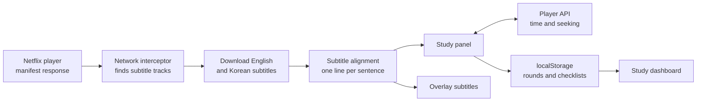

<div align="center">


<h1>netflix-subtitle-study</h1>

<p>A Chrome extension that turns Netflix English and Korean subtitles into a script, so you can study a language sentence by sentence while you watch.</p>

[](src/manifest.json)
[](package.json)
[](tsconfig.json)
[](webpack.config.js)
[](vitest.config.ts)
[](LICENSE)

[Features](#features) · [Hotkeys](#hotkeys) · [How it works](#how-it-works) · [Quick start](#quick-start) · [Development guide](DEVELOPMENT.en.md)

[한국어](README.md) | **English**

</div>

<p align="center">
  
  <br/>
  <sub>Made with invented dialogue. In real use, the Netflix video plays on the left. The interface is in Korean.</sub>
</p>

## About

When you learn from subtitles, replaying sentences, keeping a script, and tracking your progress all take extra work. This extension adds a study panel beside the Netflix player and handles all of that in one place.

It lines up the English and Korean subtitles of the current video into a single script, then adds playback controls such as sentence looping and auto-pause, along with study records for each round. Records are stored in the browser's `localStorage`.

## Features

- **Dual-language script**: Aligns the English and Korean subtitles of the current video by time and shows them side by side. The video must have both subtitle tracks.
- **Live script tracking**: Highlights the sentence being played and scrolls to it. Click a sentence to play from there.
- **Sentence-level playback**: Loop a sentence, pause after every line, or pause at the end of a page.
- **Skip silent stretches**: Skip gaps of 5 seconds or more entirely, or use smart skim to jump 5 seconds at a time with a 2-second preview.
- **Subtitles over the video**: Shows English and Korean subtitles on the player, with each language hideable.
- **Five-step checklist**: Track pre-study, watching without subtitles, script analysis, shadowing, and composition practice on each page. Add a round to keep its records separate.
- **Highlights and notes**: Drag over a word or phrase in an English line to highlight it or attach a multi-line note. Click a highlight to reopen its note; the video pauses while a note is open. Notes are saved per video and are kept when you reset study progress.
- **AI prompt copy**: Copy a pre-study prompt or a composition prompt containing the current page's script, then paste it into an AI chatbot.
- **Study dashboard**: Adds a tab to the Netflix top menu where you can see your videos, progress, and rounds, and pick up where you left off.

You can also adjust the panel width, font size, and lines per page (20, 50, 100, or 150).

<p align="center">
  
  <br/>
  <sub>The study dashboard. Titles and images are placeholder data.</sub>
</p>

## Hotkeys

Hotkeys are ignored while you type in an input field.

| Key | Action | Description |
| :-: | :-- | :-- |
| `Q` | Toggle auto-pause | Pauses the video after every line. |
| `R` | Toggle sentence loop | Repeats the current sentence. |
| `T` | Toggle study panel | Shows or hides the panel on the right. |
| `W` | Step back | Goes to the previous line, or moves back part of the way when the gap is wide. |
| `E` | Step forward | Goes to the next line, or jumps 5 seconds if it is 5 seconds or more away. |
| `A` | Previous sentence | Plays from the start of the previous sentence. |
| `S` | Current sentence | Replays from the start of the current sentence. |
| `D` | Next sentence | Plays from the start of the next sentence. |

## How it works



The extension's script runs inside the Netflix page and wraps `JSON.parse` to find the video manifest. It picks both subtitle tracks from the manifest, downloads them, and aligns them by time into a script. The panel reads the player's current time with `requestAnimationFrame` to find the active sentence.

## Quality

- Vitest and React Testing Library cover subtitle parsing and alignment, playback hooks, hotkeys, data migration, and UI components.
- TypeScript type checks and ESLint run through npm scripts.
- Older checklist data is converted to the round-based format when loaded.

## Tech stack

- **Extension**: Chrome Manifest V3
- **Frontend**: React 18, TypeScript 4.9, CSS and SCSS
- **Build**: Webpack 5, Webpack Dev Server 4, Babel
- **Testing**: Vitest 4, React Testing Library, jsdom

## Quick start

The extension is not on the Chrome Web Store, so you build and install it yourself. You need Node.js 18 or later and Chrome or another Chromium-based browser.

```bash
git clone https://github.com/mivomad33/netflix-subtitle-study.git
cd netflix-subtitle-study
npm install
npm run build
```

1. Enter `chrome://extensions/` in the Chrome address bar.
2. Turn on **Developer mode** in the top right.
3. Click **Load unpacked** and select the `build` folder.
4. Play a Netflix video that has English and Korean subtitles. The study panel opens on the right.

See the [development guide](DEVELOPMENT.en.md) for the dev server, tests, and stored data.

## Project structure

```text
src/
├── manifest.json          # Extension settings
├── pages/
│   ├── Background/        # Service worker
│   ├── ContentLoader/     # Entry that injects the study script
│   └── Content/           # Study panel, dashboard, playback control
│       ├── components/    # Panel components
│       ├── hooks/         # Player integration, hotkeys
│       └── utils/         # Subtitles, UI injection, layout
└── types/                 # Shared types
utils/                     # Build and dev server scripts
assets/readme/             # README images
```

## License

Released under the [MIT](LICENSE) License. This project is not affiliated with or endorsed by Netflix. Please review the Netflix Terms of Use yourself.
