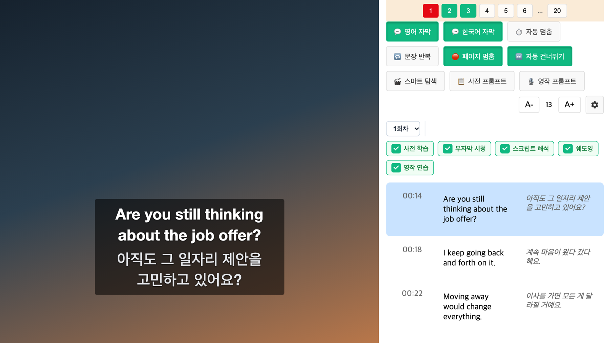
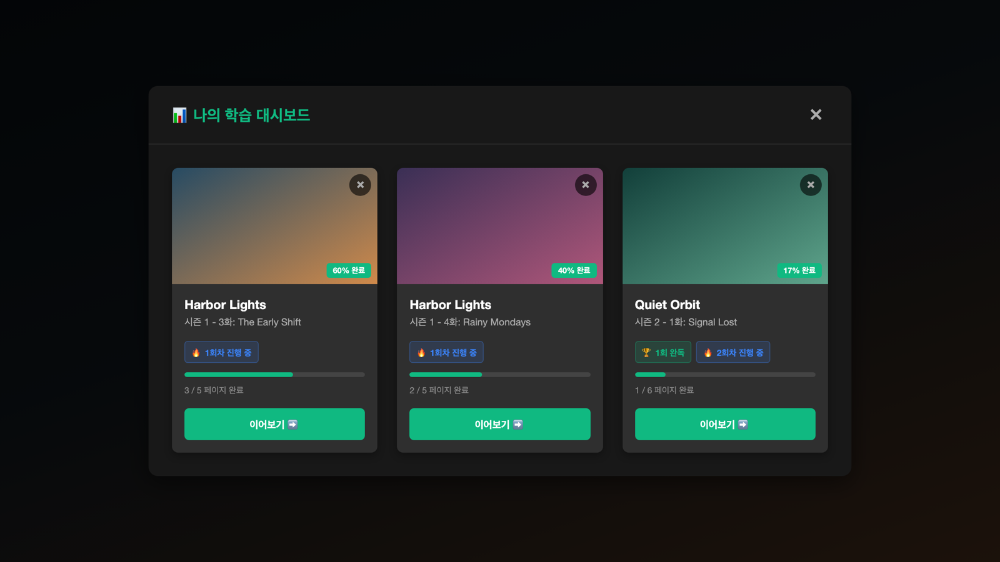
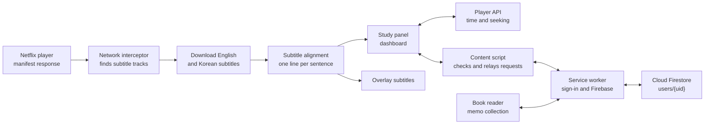

<div align="center">


<h1>netflix-subtitle-study</h1>

<p>A Chrome extension that turns Netflix English and Korean subtitles into a script, so you can study a language sentence by sentence while you watch. You can also paste in an English book and take notes as you read.</p>

[](src/manifest.json)
[](package.json)
[](tsconfig.json)
[](webpack.config.js)
[](vitest.config.ts)
[](LICENSE)

[Features](#features) · [Book reader and memo collection](#book-reader-and-memo-collection) · [Sign-in and data](#sign-in-and-data) · [Hotkeys](#hotkeys) · [How it works](#how-it-works) · [Quick start](#quick-start) · [Development guide](DEVELOPMENT.en.md)

[한국어](README.md) | **English**

</div>

<p align="center">
  
  <br/>
  <sub>Made with invented dialogue. In real use, the Netflix video plays on the left. The interface is in Korean.</sub>
</p>

## About

When you learn from subtitles, replaying sentences, keeping a script, and tracking your progress all take extra work. This extension adds a study panel beside the Netflix player and handles all of that in one place.

It lines up the English and Korean subtitles of the current video into a single script, then adds playback controls such as sentence looping and auto-pause, along with study records for each round. Paste in the text of an English book to highlight and take notes the same way, and find your Netflix and book notes in one place.

Notes, books, and study records such as rounds and checklists, along with settings, are saved to Firebase (Cloud Firestore) after you sign in with a Google account. Sign in with the same account on another computer or Chrome profile and you see the same data, and it survives uninstalling the extension or clearing Netflix site data. See [Sign-in and data](#sign-in-and-data) for details.

## Features

- **Dual-language script**: Aligns the English and Korean subtitles of the current video by time and shows them side by side. The video must have both subtitle tracks.
- **Live script tracking**: Highlights the sentence being played and scrolls to it. Click a sentence to play from there.
- **Sentence-level playback**: Loop a sentence, pause after every line, or pause at the end of a page.
- **Skip silent stretches**: Skip gaps of 5 seconds or more entirely, or use smart skim to jump 5 seconds at a time with a 2-second preview.
- **Subtitles over the video**: Shows English and Korean subtitles on the player, with each language hideable.
- **Five-step checklist**: Track pre-study, watching without subtitles, script analysis, shadowing, and composition practice on each page. Add a round to keep its records separate.
- **Highlights and notes**: Drag over a word or phrase in an English line to highlight it or attach a multi-line note. Click a highlight to reopen its note; the video pauses while a note is open. Notes are saved to your account, so they are kept when you reset study progress or clear Netflix site data, and you can browse them together with book notes in the [memo collection](#book-reader-and-memo-collection).
- **AI prompt copy**: Copy a pre-study prompt or a composition prompt containing the current page's script, then paste it into an AI chatbot.
- **Study dashboard**: Adds a tab to the Netflix top menu where you can see your videos, progress, and rounds, and pick up where you left off. You can also open the book reader and the memo collection from the dashboard.

You can also adjust the panel width, font size, and lines per page (20, 50, 100, or 150).

<p align="center">
  
  <br/>
  <sub>The study dashboard. Titles and images are placeholder data.</sub>
</p>

## Book reader and memo collection

Pages inside the extension let you read English books and browse the notes you left on Netflix and in books. Click the extension icon in the toolbar to open the popup, then click **원서 리더** (book reader) or **메모 모아 보기** (memo collection) to open it in a new tab. The Netflix study dashboard has the same two links. Both pages require signing in with a Google account (see [Sign-in and data](#sign-in-and-data)).

- **Add a book**: Enter a title (required) and an author (optional), then paste the whole text. **본문 정리** (clean up text, on by default) joins line-end breaks, rejoins words split by hyphens, and splits paragraphs on blank lines. Chapter headings such as `Chapter 1`, `CHAPTER ONE`, `Part 2`, a Roman or Arabic numeral alone on a line, and `Prologue` or `Epilogue` are detected and used to split chapters. Before saving, the preview lets you rename chapters, merge a chapter into the previous one, or start a new chapter at any paragraph. A book can hold up to 2,000,000 characters.
- **Read a book**: Pick a chapter from the chapter list to see its text paragraph by paragraph. Highlight and take notes the same way as in the Netflix study panel, and see the chapter's notes in **이 장의 메모** (notes in this chapter) beside the text. The reader remembers the last chapter and paragraph for each book and resumes there, and the book list shows where to continue, such as "이어 읽기: 2장 〈chapter title〉" (continue: chapter 2). Use **가−** and **가+** to change the font size.
- **Study completion and progress**: Mark a chapter as studied with its check in the chapter list or with **이 장 학습 완료** (mark this chapter studied) at the end of the text; click again to clear it. Completion changes only when you set it, never just because you read or listened to the end. The book list and the reader show progress with a bar, such as "45% · 12장 중 5장 완료" (45%, 5 of 12 chapters studied). Progress is weighted by characters, not by chapter count, so a short preface does not count as much as a long chapter. It reaches 100% only when every chapter is done.
- **Read aloud**: The reading bar above the text reads the book sentence by sentence with the browser's built-in voices. See [Read aloud](#read-aloud) below.
- **Edit the text**: The text cannot be edited after saving. To change it, delete the book from the book list and add it again. Deleting a book also removes its notes and reading position.
- **Memo collection**: Shows Netflix and book notes in one list, most recently edited first. Search the selected text, note, source text, and title without regard to case, and filter by source (all, Netflix, books, one book, or one video) and by **메모 글이 있는 것만** (only with note text). You can edit or delete notes from the list. **원래 위치로** (go to source) opens the book chapter at the highlight, or opens the Netflix video at that scene in a new tab. Notes whose source text changed are kept and marked "위치를 찾지 못함" (position not found).
- **Backup**: **백업 내보내기** (export backup) at the top of the page downloads all books, notes, reading positions, study completion records, book reader settings (font size and reading settings), and Netflix study records (checklists, studied videos, lines per page, and panel settings) in your account as a single `nf-study-backup-YYYYMMDD.json` file. **백업 가져오기** (import backup) asks for confirmation, then merges the file into your account. Matching items keep whichever was edited last, and nothing you already have is deleted. A file in the wrong format, or one that would take you over 20 MB after merging, changes nothing. Backup files use format version 2, and version 1 files made by earlier versions can still be imported.

### Read aloud

It uses the browser's built-in voices (Web Speech API), so it is free and needs no new permission.

- **Reading bar**: **재생**·**일시정지**·**정지** (play, pause, stop), **이전 문장**·**다음 문장** (previous and next sentence), rate (0.5x to 2x), voice, **문장 반복** (repeat sentence) and **문장마다 멈춤** (pause after each sentence). Hover over a paragraph and click the ▶ on its left (read from here) to start there. The first play starts at the paragraph you were reading, and play after a pause restarts that sentence from its beginning. While reading, click a sentence in the text to read from it.
- **Current sentence**: The sentence being read gets a blue background, and the page follows it when it leaves the screen. Scroll yourself and following stops, with a **읽는 곳으로** (back to reading) button to return.
- **End of chapter**: Reading stops at the end of a chapter and offers **다음 장 읽기** (read next chapter).
- **Read a selection**: Select text and click **읽기** (read) in the highlight toolbar to hear only that text.
- **Shadowing**: **문장 반복** repeats the current sentence until you turn it off, and **문장마다 멈춤** stops after each sentence. After repeating it yourself, press play or `D` for the next sentence.
- **Voices**: Only English voices are listed. Natural voices and macOS high-quality voices (Premium, Enhanced) come first; if there are none, plain device voices are shown. Your voice and reading settings are remembered.
- **Online voices**: Voices marked "(온라인)" (online), such as Chrome's "Google US English", are at the end of the list. If you choose one, **the text being read is sent to Google's servers.** Otherwise a device voice reads.
- **Getting better English voices (macOS)**: In System Settings › Accessibility › Spoken Content, pick or download an English voice from the **System Voice** menu (voices with a download icon are downloaded from Apple over the internet). Reopen Chrome afterward. When no English device voice is available, the reading bar shows this guidance instead.

## Sign-in and data

You need to sign in with a Google account to use the book reader and the memo collection, or to save notes, checklists, and study records on Netflix. Click **Google로 로그인** (sign in with Google) in the book reader or the memo collection to open the Google sign-in window (`chrome.identity.launchWebAuthFlow`, scope `openid email`). You do not need to be signed in to your Chrome profile. The subtitle study features on Netflix (dual-language script, playback controls, subtitles over the video) work without signing in, using default settings; settings you change while signed out are not saved. **로그인 화면 열기** (open sign-in page) in the study panel opens the sign-in page.

- **Where data lives**: Notes, books and chapter text, reading positions, study completion records, book reader settings, and Netflix checklists, studied videos, lines per page, and panel settings are all stored in your own area (`users/{uid}`) of Cloud Firestore in Seoul (`asia-northeast3`). Security rules let each user read and write only their own area.
- **Storage limit**: Each user can store up to 20 MB. The top of the book reader shows usage such as "사용량 1.2 MB / 20 MB" (usage), and a save that would go over the limit is not made; a notice explains why.
- **Free quota**: The project runs on the free Firebase Spark plan, and all users share its daily read, write, and delete limits. When the limit is reached, saving stops for the rest of the day with a notice. The limits reset at midnight Pacific time (4 or 5 p.m. in Korea). The subtitle study features on Netflix keep working with default settings in the meantime.
- **Sign out**: Your data stays in your account and appears again when you sign back in. The temporary copy on this computer (the Firestore cache) is deleted.
- **Delete account**: **탈퇴** (delete account) in the book reader asks for confirmation, then deletes all of that account's Firestore data and the Firebase account itself. This cannot be undone, so exporting a backup first is recommended.
- **Privacy policy and copyright notice**: See the [privacy policy](https://nf-subtitle-study-21cae.web.app/privacy/) and the [copyright notice](https://nf-subtitle-study-21cae.web.app/copyright/). The same links appear on the sign-in screen and next to account deletion.
- **Permissions and network connections**: The permissions are `storage`, `unlimitedStorage`, and `identity`, with no `host_permissions`. `identity` is used to open the Google sign-in window. The extension connects only to Firebase (Firestore and authentication) and the Google domains needed for Google sign-in, and loads no external scripts.

### Updating from an earlier version

**Before updating, export a backup file with 백업 내보내기 (export backup) in the earlier version's book reader.** The updated extension does not move the data the earlier version saved on this computer into your account; it deletes it, and deleted data cannot be recovered.

- **What is deleted**: This extension's study data in `chrome.storage.local` (notes, books, chapter text, reading positions, study completion records, book reader settings), and this extension's `NF_` study record keys in the Netflix site's `localStorage` (studied videos, checklists, lines per page, panel settings, old notes). `NF_lingoActive` and `NF_preferredTextLocale`, which are used for subtitle handling, are kept.
- **Restoring**: After signing in, use **백업 가져오기** (import backup) in the book reader to merge the file you exported into your account. Backups from earlier versions do not contain Netflix checklists or studied-video records, so those records cannot be restored.

## Hotkeys

Hotkeys are ignored while you type in an input field.

| Key | Action | Description |
| :-: | :-- | :-- |
| `Space` | Play/pause | Plays or pauses the video even while the study panel has focus. A panel button you just clicked is not pressed again. |
| `Q` | Toggle auto-pause | Pauses the video after every line. |
| `R` | Toggle sentence loop | Repeats the current sentence. |
| `T` | Toggle study panel | Shows or hides the panel on the right. |
| `W` | Step back | Goes to the previous line, or moves back part of the way when the gap is wide. |
| `E` | Step forward | Goes to the next line, or jumps 5 seconds if it is 5 seconds or more away. |
| `A` | Previous sentence | Plays from the start of the previous sentence. |
| `S` | Current sentence | Replays from the start of the current sentence. |
| `D` | Next sentence | Plays from the start of the next sentence. |

Read aloud in the book reader uses the same keys. They are ignored in the memo editor, input fields, and select boxes.

| Key | Action | Description |
| :-: | :-- | :-- |
| `Space` | Play/pause | A focused button is not pressed again. |
| `A` | Previous sentence | Reads from the previous sentence. |
| `S` | Current sentence | Reads the current sentence again from its beginning. |
| `D` | Next sentence | Reads from the next sentence. |
| `Q` | Toggle pause after each sentence | Stops after one sentence. |
| `R` | Toggle repeat sentence | Repeats the current sentence. |

## How it works



The extension's script runs inside the Netflix page and wraps `JSON.parse` to find the video manifest. It picks both subtitle tracks from the manifest, downloads them, and aligns them by time into a script. The panel reads the player's current time with `requestAnimationFrame` to find the active sentence.

Notes and study records are stored in Cloud Firestore, and Firebase (sign-in and Firestore) runs only in the extension's service worker. The script inside the Netflix page cannot use `chrome.*` APIs, so it sends requests to the content script in the same tab with `window.postMessage`, and the content script checks each request before passing it to the service worker over a `chrome.runtime` port. The Netflix side can only work with Netflix notes and study records. The book reader and the memo collection also ask the service worker over a port. When something changes on another page or another computer, the service worker notifies the open pages so they update.

## Quality

- Vitest and React Testing Library cover subtitle parsing and alignment, playback hooks, hotkeys, old data cleanup, text cleanup and chapter splitting, memo search, backup, the sign-in screens, and UI components.
- Integration tests run against the Firebase emulators (Auth and Firestore) to cover the security rules, Firestore storage, backup, and account deletion.
- End-to-end tests that launch the built extension with Playwright run locally.
- TypeScript type checks and ESLint run through npm scripts.
- GitHub Actions runs type checks, ESLint, tests, the emulator tests, the build, and a check of the build output (permissions, external addresses it connects to, secret values, and so on) on every push and pull request.
- Older checklist data is converted to the round-based format when loaded.

## Tech stack

- **Extension**: Chrome Manifest V3
- **Frontend**: React 18, TypeScript 4.9, CSS and SCSS
- **Backend**: Firebase Authentication (Google sign-in), Cloud Firestore, Firebase Hosting (privacy policy and copyright notice)
- **Build**: Webpack 5, Webpack Dev Server 4, Babel
- **Testing**: Vitest 4, React Testing Library, jsdom, Firebase emulators, Playwright

## Quick start

The extension is not on the Chrome Web Store, so you build and install it yourself. You need Node.js 24 (recommended, see [.nvmrc](.nvmrc)) and Chrome or another Chromium-based browser.

```bash
git clone https://github.com/mivomad33/netflix-subtitle-study.git
cd netflix-subtitle-study
npm install
npm run build
```

1. Enter `chrome://extensions/` in the Chrome address bar.
2. Turn on **Developer mode** in the top right.
3. Click **Load unpacked** and select the `build` folder.
4. Play a Netflix video that has English and Korean subtitles. The study panel opens on the right.
5. Click the extension icon in the toolbar to open the book reader or the memo collection. The first time, click **Google로 로그인** (sign in with Google).

If you were using an earlier version, read [Updating from an earlier version](#updating-from-an-earlier-version) and export a backup before updating.

Google sign-in and saving are enabled only when a Firebase web config file (`firebase.config.local.json`, not committed) exists at build time. Without it the build still succeeds, but the book reader and the memo collection show "Firebase 설정이 없습니다" (Firebase is not configured) instead of sign-in, and on Netflix only the subtitle study features work, with default settings. The [development guide](DEVELOPMENT.en.md#firebase-config) explains how to create the config file and how to build with your own Firebase project.

The extension ID is fixed by `key` in [manifest.json](src/manifest.json), so moving the `build` folder does not change it. The Google sign-in window returns to an address based on this ID (`https://<extension ID>.chromiumapp.org/`), so sign-in does not work with a different ID.

See the [development guide](DEVELOPMENT.en.md) for the dev server, Firebase config, tests, CI, and stored data.

## Project structure

```text
src/
├── manifest.json          # Extension settings
├── pages/
│   ├── Background/        # Service worker (sign-in, Firestore, old data cleanup)
│   ├── ContentLoader/     # Entry that injects the study script, relays requests to the service worker
│   ├── Content/           # Study panel, dashboard, playback control
│   │   ├── components/    # Panel components
│   │   ├── hooks/         # Player integration, hotkeys
│   │   └── utils/         # Subtitles, UI injection, layout
│   ├── Reader/            # Book reader, memo collection, backup, sign-in and account UI
│   └── Popup/             # Toolbar popup
├── shared/                # Code shared by the Netflix pages, the book reader, and the service worker
│   ├── auth/              # Sign-in state
│   ├── firebase/          # Firebase web config, policy links
│   ├── memo/              # Memo model
│   ├── rpc/               # Port messages between pages or the content script and the service worker
│   ├── storage/           # Shared storage, Firestore document layout
│   ├── bridge/            # Messages between the Netflix page and the service worker
│   ├── text/              # Text cleanup, chapter splitting
│   └── ui/                # Highlight and note UI, storage error notices
├── test/                  # Emulator test helpers, security rules tests
└── types/                 # Shared types
e2e/                       # End-to-end tests of the built extension
site/                      # Privacy policy and copyright notice (Firebase Hosting)
firestore.rules            # Firestore security rules
scripts/                   # Build output check, performance measurement
utils/                     # Build and dev server scripts
.github/workflows/         # CI
docs/                      # Design baseline, specs
assets/readme/             # README images
```

## License

Released under the [MIT](LICENSE) License. This project is not affiliated with or endorsed by Netflix. Please review the Netflix Terms of Use yourself.
