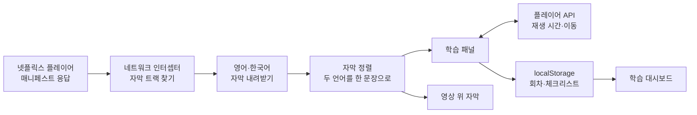

<div align="center">


<h1>netflix-subtitle-study</h1>

<p>넷플릭스 영어·한국어 자막으로 대본을 만들고, 영상을 보면서 문장 단위로 외국어를 공부하는 크롬 확장 프로그램입니다.</p>

[](src/manifest.json)
[](package.json)
[](tsconfig.json)
[](webpack.config.js)
[](vitest.config.ts)
[](LICENSE)

[주요 기능](#주요-기능) · [단축키](#단축키) · [동작 방식](#동작-방식) · [빠른 시작](#빠른-시작) · [개발 문서](DEVELOPMENT.md)

**한국어** | [English](README.en.md)

</div>

<p align="center">
  
  <br/>
  <sub>직접 쓴 가짜 대사로 만든 화면입니다. 실제로는 넷플릭스 영상이 왼쪽에 재생됩니다.</sub>
</p>

## 소개

자막을 보며 영상을 따라가다 보면 문장을 다시 듣고, 대본을 정리하고, 어디까지 공부했는지 기록하는 일이 번거롭습니다. 이 확장 프로그램은 넷플릭스 시청 화면 옆에 학습 패널을 붙여 이 과정을 한곳에서 처리합니다.

재생 중인 영상의 영어·한국어 자막을 하나의 대본으로 맞춘 뒤, 문장 반복과 자동 멈춤 같은 재생 제어와 회차별 학습 기록을 제공합니다. 학습 기록은 브라우저 `localStorage`에 저장합니다.

## 주요 기능

- **두 언어 대본**: 재생 중인 영상의 영어·한국어 자막을 시간 기준으로 맞춰 나란히 보여 줍니다. 영상에 두 자막이 모두 있어야 합니다.
- **실시간 대본 추적**: 지금 재생 중인 문장을 강조하고 그 위치로 스크롤합니다. 문장을 누르면 그 지점부터 재생합니다.
- **문장 단위 재생 제어**: 문장 무한 반복, 문장마다 자동 멈춤, 페이지 끝 자동 멈춤을 켤 수 있습니다.
- **대사 없는 구간 넘기기**: 5초 이상 대사가 없는 구간을 통째로 건너뛰거나, 5초씩 넘기며 2초간 화면을 미리 보는 스마트 탐색을 쓸 수 있습니다.
- **영상 위 자막**: 영어·한국어 자막을 영상 위에 함께 표시하고, 언어별로 숨길 수 있습니다.
- **5단계 체크리스트**: 페이지마다 사전 학습, 무자막 시청, 스크립트 해석, 쉐도잉, 영작 연습을 체크합니다. 회차를 추가하면 기록을 따로 남깁니다.
- **AI 프롬프트 복사**: 현재 페이지의 대본이 담긴 사전 학습 프롬프트와 영작 연습 프롬프트를 복사해 AI 챗봇에 붙여 넣을 수 있습니다.
- **학습 대시보드**: 넷플릭스 상단 메뉴에 탭을 추가해 공부한 영상, 진행률, 회차를 모아 보고 이어 볼 수 있습니다.

패널 너비, 글자 크기, 페이지당 대사 수(20·50·100·150개)도 조절할 수 있습니다.

<p align="center">
  
  <br/>
  <sub>학습 대시보드. 작품 정보와 이미지는 가짜 데이터입니다.</sub>
</p>

## 단축키

입력창에 글을 쓰는 동안에는 동작하지 않습니다.

| 키 | 기능 | 설명 |
| :-: | :-- | :-- |
| `Q` | 자동 멈춤 켜기/끄기 | 대사가 끝날 때마다 영상을 멈춥니다. |
| `R` | 문장 반복 켜기/끄기 | 현재 문장을 계속 반복합니다. |
| `T` | 학습 패널 열기/닫기 | 오른쪽 패널을 보이거나 숨깁니다. |
| `W` | 뒤로 이동 | 이전 대사로 가거나, 대사 간격이 넓으면 시간을 나눠 되돌아갑니다. |
| `E` | 앞으로 이동 | 다음 대사로 가거나, 5초 이상 남았으면 5초 앞으로 갑니다. |
| `A` | 이전 문장 | 이전 문장의 시작부터 재생합니다. |
| `S` | 현재 문장 | 현재 문장의 시작부터 다시 재생합니다. |
| `D` | 다음 문장 | 다음 문장의 시작부터 재생합니다. |

## 동작 방식



확장 프로그램의 스크립트가 넷플릭스 페이지 안에서 실행되며 `JSON.parse`를 감싸 영상 매니페스트를 찾습니다. 매니페스트에서 두 언어의 자막 트랙을 골라 내려받고, 시간대를 기준으로 맞춰 대본을 만듭니다. 패널은 `requestAnimationFrame`으로 플레이어의 재생 시간을 읽어 현재 문장을 찾습니다.

## 품질 관리

- Vitest와 React Testing Library로 자막 파싱·정렬, 재생 훅, 단축키, 데이터 이전, 화면 구성 요소를 테스트합니다.
- TypeScript 타입 검사와 ESLint를 npm 스크립트로 실행할 수 있습니다.
- 예전 형식의 체크리스트는 불러올 때 회차 구조로 자동 변환합니다.

## 기술 스택

- **확장 프로그램**: Chrome Manifest V3
- **프런트엔드**: React 18, TypeScript 4.9, CSS·SCSS
- **빌드**: Webpack 5, Webpack Dev Server 4, Babel
- **테스트**: Vitest 4, React Testing Library, jsdom

## 빠른 시작

Chrome Web Store에는 올리지 않았으므로 직접 빌드해 설치합니다. Node.js 18 이상과 Chrome 또는 Chromium 기반 브라우저가 필요합니다.

```bash
git clone https://github.com/mivomad33/netflix-subtitle-study.git
cd netflix-subtitle-study
npm install
npm run build
```

1. Chrome 주소창에 `chrome://extensions/`를 입력합니다.
2. 오른쪽 위의 **개발자 모드**를 켭니다.
3. **압축해제된 확장 프로그램을 로드합니다**를 누르고 `build` 폴더를 선택합니다.
4. 넷플릭스에서 영어·한국어 자막이 있는 영상을 재생하면 오른쪽에 학습 패널이 열립니다.

개발 서버, 테스트, 저장 데이터 구조는 [개발 문서](DEVELOPMENT.md)에 있습니다.

## 프로젝트 구조

```text
src/
├── manifest.json          # 확장 프로그램 설정
├── pages/
│   ├── Background/        # 서비스 워커
│   ├── ContentLoader/     # 페이지에 학습 스크립트를 넣는 진입점
│   └── Content/           # 학습 패널, 대시보드, 재생 제어
│       ├── components/    # 패널 구성 요소
│       ├── hooks/         # 플레이어 연동, 단축키
│       └── utils/         # 자막 처리, 화면 삽입, 레이아웃
└── types/                 # 공용 타입
utils/                     # 빌드, 개발 서버 스크립트
assets/readme/             # README 이미지
```

## 라이선스

[MIT](LICENSE) 라이선스를 따릅니다. 넷플릭스와 제휴하거나 넷플릭스가 승인한 프로젝트가 아닙니다. 넷플릭스 이용 약관은 사용자가 직접 확인해 주세요.
