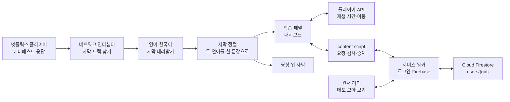

<div align="center">


<h1>netflix-subtitle-study</h1>

<p>넷플릭스 영어·한국어 자막으로 대본을 만들고, 영상을 보면서 문장 단위로 외국어를 공부하는 크롬 확장 프로그램입니다. 영어 원서를 붙여 넣어 읽으며 메모할 수도 있습니다.</p>

[](src/manifest.json)
[](package.json)
[](tsconfig.json)
[](webpack.config.js)
[](vitest.config.ts)
[](LICENSE)

[주요 기능](#주요-기능) · [원서 리더와 메모 모아 보기](#원서-리더와-메모-모아-보기) · [로그인과 데이터](#로그인과-데이터) · [단축키](#단축키) · [동작 방식](#동작-방식) · [빠른 시작](#빠른-시작) · [개발 문서](DEVELOPMENT.md)

**한국어** | [English](README.en.md)

</div>

<p align="center">
  
  <br/>
  <sub>직접 쓴 가짜 대사로 만든 화면입니다. 실제로는 넷플릭스 영상이 왼쪽에 재생됩니다.</sub>
</p>

## 소개

자막을 보며 영상을 따라가다 보면 문장을 다시 듣고, 대본을 정리하고, 어디까지 공부했는지 기록하는 일이 번거롭습니다. 이 확장 프로그램은 넷플릭스 시청 화면 옆에 학습 패널을 붙여 이 과정을 한곳에서 처리합니다.

재생 중인 영상의 영어·한국어 자막을 하나의 대본으로 맞춘 뒤, 문장 반복과 자동 멈춤 같은 재생 제어와 회차별 학습 기록을 제공합니다. 영어 원서 본문을 붙여 넣으면 같은 방식으로 하이라이트와 메모를 남길 수 있고, 넷플릭스와 원서의 메모를 한곳에서 찾아볼 수 있습니다.

메모, 원서, 회차·체크리스트 같은 학습 기록과 설정은 Google 계정으로 로그인해 Firebase(Cloud Firestore)에 저장합니다. 그래서 다른 PC나 다른 크롬 프로필에서 같은 계정으로 로그인하면 같은 데이터가 보이고, 확장 프로그램을 제거하거나 넷플릭스 사이트 데이터를 지워도 남습니다. 자세한 내용은 [로그인과 데이터](#로그인과-데이터)에 있습니다.

## 주요 기능

- **두 언어 대본**: 재생 중인 영상의 영어·한국어 자막을 시간 기준으로 맞춰 나란히 보여 줍니다. 영상에 두 자막이 모두 있어야 합니다.
- **실시간 대본 추적**: 지금 재생 중인 문장을 강조하고 그 위치로 스크롤합니다. 문장을 누르면 그 지점부터 재생합니다.
- **문장 단위 재생 제어**: 문장 무한 반복, 문장마다 자동 멈춤, 페이지 끝 자동 멈춤을 켤 수 있습니다.
- **대사 없는 구간 넘기기**: 5초 이상 대사가 없는 구간을 통째로 건너뛰거나, 5초씩 넘기며 2초간 화면을 미리 보는 스마트 탐색을 쓸 수 있습니다.
- **영상 위 자막**: 영어·한국어 자막을 영상 위에 함께 표시하고, 언어별로 숨길 수 있습니다.
- **5단계 체크리스트**: 페이지마다 사전 학습, 무자막 시청, 스크립트 해석, 쉐도잉, 영작 연습을 체크합니다. 회차를 추가하면 기록을 따로 남깁니다.
- **하이라이트와 메모**: 영어 대사에서 단어나 표현을 드래그해 고른 뒤 하이라이트하거나, 그 부분에 여러 줄 메모를 남길 수 있습니다. 칠한 곳을 누르면 메모가 다시 열리고, 메모를 여는 동안에는 영상이 멈춥니다. 메모는 계정에 저장되어 학습 기록을 초기화하거나 넷플릭스 사이트 데이터를 지워도 남고, [메모 모아 보기](#원서-리더와-메모-모아-보기)에서 원서 메모와 함께 볼 수 있습니다.
- **AI 프롬프트 복사**: 현재 페이지의 대본이 담긴 사전 학습 프롬프트와 영작 연습 프롬프트를 복사해 AI 챗봇에 붙여 넣을 수 있습니다.
- **학습 대시보드**: 넷플릭스 상단 메뉴에 탭을 추가해 공부한 영상, 진행률, 회차를 모아 보고 이어 볼 수 있습니다. 대시보드에서 원서 리더와 메모 모아 보기를 열 수도 있습니다.

패널 너비, 글자 크기, 페이지당 대사 수(20·50·100·150개)도 조절할 수 있습니다.

<p align="center">
  
  <br/>
  <sub>학습 대시보드. 작품 정보와 이미지는 가짜 데이터입니다.</sub>
</p>

## 원서 리더와 메모 모아 보기

확장 프로그램 안의 화면에서 영어 원서를 읽고, 넷플릭스와 원서에 남긴 메모를 모아 봅니다. 툴바의 확장 프로그램 아이콘을 눌러 팝업을 열고 **원서 리더** 또는 **메모 모아 보기**를 누르면 새 탭으로 열립니다. 넷플릭스 학습 대시보드에도 같은 두 링크가 있습니다. 두 화면은 Google 계정으로 로그인해야 쓸 수 있습니다([로그인과 데이터](#로그인과-데이터)).

- **책 추가**: 제목(필수)과 저자(선택)를 쓰고 본문 전체를 붙여 넣습니다. **본문 정리**(기본으로 켜짐)는 줄 끝 줄바꿈을 잇고, 하이픈으로 나뉜 단어를 다시 붙이고, 빈 줄을 기준으로 문단을 나눕니다. `Chapter 1`, `CHAPTER ONE`, `Part 2`, 한 줄에 홀로 있는 로마·아라비아 숫자, `Prologue`·`Epilogue` 같은 장 제목을 찾아 장을 나눕니다. 저장하기 전 미리 보기에서 장 이름을 바꾸거나, 장을 앞 장에 합치거나, 아무 문단에서나 새 장을 시작할 수 있습니다. 책 한 권에 200만 자까지 넣을 수 있습니다.
- **원서 읽기**: 장 목록에서 장을 고르면 본문이 문단 단위로 보입니다. 넷플릭스 학습 패널과 같은 방식으로 하이라이트와 메모를 남기고, 본문 옆 **이 장의 메모**에서 그 장의 메모를 봅니다. 책마다 마지막으로 읽은 장과 문단을 기억해 다시 열면 그곳에서 이어지고, 책 목록에 "이어 읽기: 2장 〈장 이름〉"처럼 이어 읽을 곳이 보입니다. **가−**·**가+**로 글자 크기를 바꿉니다.
- **학습 완료와 진행률**: 장 목록의 체크나 본문 끝의 **이 장 학습 완료**로 장마다 공부를 끝냈는지 표시합니다(다시 누르면 꺼집니다). 완료는 직접 켤 때만 바뀌고, 끝까지 읽거나 들어도 저절로 켜지지 않습니다. 책 목록과 리더에 "45% · 12장 중 5장 완료"처럼 진행률이 막대와 함께 보입니다. 진행률은 장 수가 아니라 글자 수 기준이라, 짧은 머리말 하나가 큰 비율을 차지하지 않습니다. 모든 장을 완료해야 100%입니다.
- **소리 내어 읽기**: 본문 위의 읽기 도구로 브라우저 내장 음성이 본문을 문장 단위로 읽어 줍니다. 아래 [소리 내어 읽기](#소리-내어-읽기)를 보세요.
- **원서 고치기**: 등록한 책의 본문, 장 제목, 장 구성, 책 제목과 지은이를 고칠 수 있고, 메모·하이라이트는 고친 글을 따라갑니다. 아래 [원서 고치기](#원서-고치기)를 보세요. 책 목록에서 책을 지우면 그 책의 메모와 읽기 위치도 함께 지워집니다.
- **메모 모아 보기**: 넷플릭스와 원서의 메모를 최근에 고친 순서로 한 목록에 보여 줍니다. 고른 글, 메모, 원문, 제목에서 대소문자 구분 없이 찾고, 출처(전체·넷플릭스·원서·책 한 권·영상 하나)와 **메모 글이 있는 것만**으로 거를 수 있습니다. 목록에서 메모를 고치거나 지울 수 있고, **원래 위치로**를 누르면 원서는 그 하이라이트가 있는 장을 열고, 넷플릭스는 그 장면부터 영상을 새 탭으로 엽니다. 원문이 바뀌어 자리를 찾지 못한 메모도 지우지 않고 "위치를 찾지 못함"으로 표시합니다.
- **백업**: 화면 위쪽의 **백업 내보내기**는 계정에 있는 책, 메모, 읽기 위치, 학습 완료 기록, 원서 리더 설정(글자 크기와 읽기 설정), 넷플릭스 학습 기록(체크리스트, 학습한 영상, 페이지당 대사 수, 패널 설정)을 모두 `nf-study-backup-YYYYMMDD.json` 파일 하나로 내려받습니다. **백업 가져오기**는 확인을 받은 뒤 파일을 계정에 합칩니다. 같은 항목끼리는 더 나중에 고친 쪽을 남기며, 이미 있는 것은 지우지 않습니다. 형식이 맞지 않는 파일이나 합친 뒤 20MB를 넘는 파일은 아무것도 바꾸지 않습니다. 백업 파일은 형식 버전 2이고, 이전 버전이 만든 버전 1 파일도 가져올 수 있습니다.

### 원서 고치기

오타처럼 등록한 뒤에 눈에 띈 곳을 책을 지우지 않고 고칩니다.

- **들어가는 길**: 리더의 장 목록 위, 진행률 아래의 **책 편집**을 누르면 책 편집 화면이 열립니다. 읽다가 오타를 보면 본문 위의 **이 장 고치기**로 지금 보는 장의 본문 편집을 바로 엽니다. 읽던 문단에서 열리고, 저장하거나 취소하면 그 자리로 돌아옵니다.
- **책 편집 화면**: 책 제목과 지은이, 장 제목을 고칩니다(각각 200자까지, 입력칸을 벗어나거나 Enter를 누르면 저장). **↑**·**↓**로 장 순서를 바꾸고, **장 추가**로 맨 끝에 새 장을 더하고(등록할 때와 같은 **본문 정리**를 고를 수 있고, 장을 자동으로 나누지 않습니다), **본문 고치기**로 그 장의 본문 편집을 엽니다. 제목이나 순서를 바꿔도 메모, 읽기 위치, 학습 완료는 그대로입니다.
- **본문 고치기**: 장 전체가 입력칸 하나에 문단 사이 빈 줄과 함께 열립니다. **줄바꿈마다 문단이 나뉩니다.** 저장할 때 빈 줄은 사라지고, 글이 있는 줄 하나가 문단 하나가 됩니다. 그 장 안에서 **찾아 바꾸기**(**다음 찾기**·**바꾸기**·**모두 바꾸기**, **대소문자 구분**)를 쓸 수 있고, 저장 버튼 옆에 "문단 120→118 · 글자 −340"처럼 바뀐 정도가 보입니다. 저장하지 않고 나가려 하면 확인을 받습니다.
- **메모와 하이라이트**: 고른 글이 그대로면 같은 문단의 다른 곳을 고치거나, 문단을 더하고 지우고 합치고 나눠도 그 글에 붙어 있습니다. 고른 글 안의 오타를 고치면 메모는 남고 고른 글이 고친 글로 바뀝니다. 고른 글을 통째로 지우거나, 고친 곳이 고른 글의 경계에 걸치거나, 고른 글 가운데에서 문단을 나누면 그 메모는 붙일 수 없습니다. 이런 메모가 있으면 저장하기 전에 목록으로 보여 주고 **계속 고치기**와 **그래도 저장** 가운데 고르게 합니다. 저장해도 메모 글은 지워지지 않고 메모 모아 보기에 "위치를 찾지 못함"으로 남습니다. 글자가 10% 넘게 줄어드는 저장도 한 번 확인받습니다.
- **글을 다른 장으로 옮기기**: 옮길 문단을 잘라 내고 저장한 다음(메모가 떨어진다는 확인이 나오면 **그래도 저장**), 다른 장에 그대로 붙여 넣고 저장합니다. 떨어져 있던 메모는 글자 하나까지 같은 문단이 저장되면 그 문단에 다시 붙습니다. 그 장에 같은 글의 문단이 둘 이상이면 붙지 않습니다. 같은 장 안에서 문단 자리를 바꾸는 것은 저장 한 번으로 됩니다.
- **장 지우기**: **지우기**는 그 장의 본문과 학습 완료 기록을 지우며 되돌릴 수 없습니다. 그 장에 메모가 있으면 **메모 남기기**(메모는 "위치를 찾지 못함"으로 남음)와 **메모도 지우기** 가운데 고릅니다. 마지막 남은 장은 지울 수 없습니다.
- **읽기 위치와 학습 완료**: 본문을 고치면 읽기 위치는 읽던 문단을 따라가고, 그 문단을 지웠으면 그 앞의 가장 가까운 문단으로 갑니다. 읽던 장을 지우면 그 자리에 온 장의 첫 문단으로 갑니다. 본문을 고쳐도 학습 완료는 바뀌지 않고, 새 장은 완료가 아닌 상태로 생기며, 진행률은 새 글자 수로 다시 계산됩니다.
- **상한과 동시 수정**: 책 한 권은 200만 자까지이고, 책이 더 길어지는 저장만 막습니다. 편집하는 동안 같은 장이 다른 탭이나 PC에서 바뀌었으면 저장하지 않고 알리며, 고치던 글은 화면에 남습니다. 다른 탭이나 PC에서 열어 둔 리더에는 고친 내용이 새로 고치지 않아도 반영됩니다.

### 소리 내어 읽기

브라우저 내장 음성(Web Speech API)을 쓰므로 무료이고 새 권한이 필요 없습니다.

- **읽기 도구**: **재생**·**일시정지**·**정지**, **이전 문장**·**다음 문장**, 속도(0.5~2배), 음성, **문장 반복**, **문장마다 멈춤**이 있습니다. 문단에 마우스를 올리면 왼쪽에 보이는 ▶(여기서부터 읽기)로 그 문단부터 읽습니다. 처음 재생하면 읽던 위치의 문단부터 읽고, 일시정지한 뒤 재생하면 그 문장 처음부터 다시 읽습니다. 읽는 중에 본문의 문장을 누르면 그 문장부터 읽습니다.
- **읽는 문장 표시**: 지금 읽는 문장이 파란 바탕으로 보이고, 화면 밖으로 나가면 따라 스크롤합니다. 직접 스크롤하면 따라가기를 멈추고 **읽는 곳으로** 버튼이 나옵니다.
- **장 끝**: 장 끝에서 멈추고 **다음 장 읽기**가 나옵니다.
- **고른 글 읽기**: 본문에서 글을 고르면 하이라이트 도구막대의 **읽기**로 고른 글만 읽습니다.
- **따라 말하기(쉐도잉)**: **문장 반복**은 현재 문장을 끌 때까지 반복하고, **문장마다 멈춤**은 문장 하나를 읽고 멈춥니다. 따라 말한 뒤 재생이나 `D`로 다음 문장을 읽습니다.
- **음성**: 영어 음성만 보입니다. 자연스러운 음성(Natural)과 macOS 고품질 음성(Premium·Enhanced)이 먼저이고, 그런 음성이 없으면 기본 기기 음성이 나옵니다. 고른 음성과 읽기 설정은 기억합니다.
- **온라인 음성**: "(온라인)"이 붙은 음성(크롬의 "Google US English" 등)은 목록 끝에 있습니다. 고르면 **읽는 글이 Google 서버로 전송됩니다.** 고르지 않으면 기기 음성으로 읽습니다.
- **고품질 영어 음성 받기(macOS)**: 시스템 설정 › 손쉬운 사용 › 말하는 콘텐츠(Spoken Content)의 **시스템 음성** 메뉴에서 영어 음성을 고르거나 내려받습니다(다운로드 아이콘이 있는 음성은 인터넷으로 받습니다). 받은 뒤 크롬을 다시 엽니다. 쓸 수 있는 영어 기기 음성이 없으면 읽기 도구 대신 이 안내가 보입니다.

## 로그인과 데이터

원서 리더와 메모 모아 보기를 쓰거나, 넷플릭스에서 메모·체크리스트·학습 기록을 저장하려면 Google 계정으로 로그인해야 합니다. 원서 리더나 메모 모아 보기에서 **Google로 로그인**을 누르면 Google 로그인 창이 열립니다(`chrome.identity.launchWebAuthFlow`, 범위 `openid email`). 크롬 프로필에 로그인하지 않아도 됩니다. 넷플릭스의 자막 학습 기능(두 언어 대본, 재생 제어, 영상 위 자막)은 로그인하지 않아도 기본 설정으로 동작하며, 그때 바꾼 설정은 저장되지 않습니다. 학습 패널의 **로그인 화면 열기**로 로그인 화면을 열 수 있습니다.

- **저장 위치**: 메모, 책과 장 본문, 읽기 위치, 학습 완료 기록, 원서 리더 설정, 넷플릭스 체크리스트·학습한 영상·페이지당 대사 수·패널 설정을 모두 Cloud Firestore(서울, `asia-northeast3`)의 사용자별 영역(`users/{uid}`)에 저장합니다. 보안 규칙으로 자기 영역만 읽고 쓸 수 있습니다.
- **저장 상한**: 사용자마다 20MB까지 저장합니다. 원서 리더 위쪽에 "사용량 1.2 MB / 20 MB"처럼 사용량이 보이고, 상한을 넘는 저장은 하지 않고 안내합니다.
- **무료 한도**: Firebase 무료 요금제(Spark)를 쓰며, 하루 읽기·쓰기·삭제 한도를 모든 사용자가 함께 씁니다. 한도에 걸리면 그날은 저장이 멈추고 안내가 보입니다. 한도는 태평양 시간 자정(한국 시간 오후 4시 또는 5시)에 다시 채워집니다. 넷플릭스 자막 학습 기능은 그동안에도 기본 설정으로 동작합니다.
- **로그아웃**: 데이터는 계정에 남아 다시 로그인하면 보입니다. 이 PC에 남은 임시 사본(Firestore 캐시)은 지웁니다.
- **탈퇴**: 원서 리더의 **탈퇴**는 확인을 받은 뒤 그 계정의 Firestore 데이터를 모두 지우고 Firebase 계정도 지웁니다. 되살릴 수 없으므로 먼저 백업 내보내기를 권합니다.
- **개인정보처리방침과 저작권 안내**: [개인정보처리방침](https://nf-subtitle-study-21cae.web.app/privacy/)과 [저작권 안내](https://nf-subtitle-study-21cae.web.app/copyright/)를 보세요. 로그인 화면과 탈퇴 근처에도 같은 링크가 있습니다.
- **권한과 네트워크 연결**: 권한은 `storage`, `unlimitedStorage`, `identity`이고 `host_permissions`는 없습니다. `identity`는 Google 로그인 창을 여는 데 씁니다. 확장 프로그램은 Firebase(Firestore와 인증)와 Google 로그인에 필요한 Google 도메인에만 연결하며, 외부 스크립트를 불러오지 않습니다.

### 이전 버전에서 업데이트할 때

**업데이트하기 전에 이전 버전의 원서 리더에서 백업 내보내기로 파일을 받아 두세요.** 업데이트한 확장 프로그램은 이전 버전이 이 PC에 저장한 데이터를 계정으로 옮기지 않고 지우며, 지운 데이터는 되살릴 수 없습니다.

- **지우는 것**: 이 확장 프로그램의 `chrome.storage.local` 학습 데이터(메모, 책, 장 본문, 읽기 위치, 학습 완료 기록, 원서 리더 설정)와, 넷플릭스 사이트 `localStorage`에 있던 이 확장 프로그램의 `NF_` 학습 기록 키(학습한 영상, 체크리스트, 페이지당 대사 수, 패널 설정, 예전 메모). 자막 처리에 쓰는 `NF_lingoActive`와 `NF_preferredTextLocale`은 남깁니다.
- **되살리기**: 로그인한 뒤 원서 리더의 **백업 가져오기**로 받아 둔 파일을 계정에 합칩니다. 이전 버전의 백업에는 넷플릭스 체크리스트와 학습한 영상 기록이 들어 있지 않으므로, 이 기록은 되살릴 수 없습니다.
- **여러 PC에서 쓸 때**: 원서 고치기가 들어간 버전부터 장 본문을 저장하는 문서 모양이 바뀌었습니다. 이 버전은 이전에 저장한 장을 그대로 읽지만, **이전 빌드는 이 버전이 저장한 장(새로 등록하거나 고친 장)을 읽지 못합니다.** 업데이트한 뒤에는 같은 계정을 쓰는 모든 PC에서 다시 빌드하고 확장 프로그램을 다시 로드하세요.

## 단축키

입력창에 글을 쓰는 동안에는 동작하지 않습니다.

| 키 | 기능 | 설명 |
| :-: | :-- | :-- |
| `Space` | 재생/정지 | 학습 패널에 포커스가 있을 때도 영상을 재생하거나 멈춥니다. 패널 버튼을 누른 뒤에도 버튼이 다시 눌리지 않습니다. |
| `Q` | 자동 멈춤 켜기/끄기 | 대사가 끝날 때마다 영상을 멈춥니다. |
| `R` | 문장 반복 켜기/끄기 | 현재 문장을 계속 반복합니다. |
| `T` | 학습 패널 열기/닫기 | 오른쪽 패널을 보이거나 숨깁니다. |
| `W` | 뒤로 이동 | 이전 대사로 가거나, 대사 간격이 넓으면 시간을 나눠 되돌아갑니다. |
| `E` | 앞으로 이동 | 다음 대사로 가거나, 5초 이상 남았으면 5초 앞으로 갑니다. |
| `A` | 이전 문장 | 이전 문장의 시작부터 재생합니다. |
| `S` | 현재 문장 | 현재 문장의 시작부터 다시 재생합니다. |
| `D` | 다음 문장 | 다음 문장의 시작부터 재생합니다. |

원서 리더의 소리 내어 읽기도 같은 키를 씁니다. 메모 입력칸, 입력칸, 고르기 상자에서는 동작하지 않습니다.

| 키 | 기능 | 설명 |
| :-: | :-- | :-- |
| `Space` | 재생/일시정지 | 버튼에 포커스가 있어도 그 버튼을 다시 누르지 않습니다. |
| `A` | 이전 문장 | 이전 문장부터 읽습니다. |
| `S` | 현재 문장 | 현재 문장을 처음부터 다시 읽습니다. |
| `D` | 다음 문장 | 다음 문장부터 읽습니다. |
| `Q` | 문장마다 멈춤 켜기/끄기 | 문장 하나를 읽고 멈춥니다. |
| `R` | 문장 반복 켜기/끄기 | 현재 문장을 계속 반복합니다. |

## 동작 방식



확장 프로그램의 스크립트가 넷플릭스 페이지 안에서 실행되며 `JSON.parse`를 감싸 영상 매니페스트를 찾습니다. 매니페스트에서 두 언어의 자막 트랙을 골라 내려받고, 시간대를 기준으로 맞춰 대본을 만듭니다. 패널은 `requestAnimationFrame`으로 플레이어의 재생 시간을 읽어 현재 문장을 찾습니다.

메모와 학습 기록은 Cloud Firestore에 저장하며, Firebase(로그인과 Firestore)는 확장 프로그램의 서비스 워커에서만 돕니다. 넷플릭스 페이지 안의 스크립트는 `chrome.*` API를 쓸 수 없으므로, 같은 탭의 content script에 `window.postMessage`로 요청하고, content script가 요청을 검사한 뒤 `chrome.runtime` 포트로 서비스 워커에 넘깁니다. 넷플릭스 쪽에서는 넷플릭스 메모와 학습 기록만 다룰 수 있습니다. 원서 리더와 메모 모아 보기도 포트로 서비스 워커에 부탁합니다. 다른 화면이나 다른 PC에서 바뀐 내용은 서비스 워커가 열린 화면에 알려 반영합니다.

## 품질 관리

- Vitest와 React Testing Library로 자막 파싱·정렬, 재생 훅, 단축키, 옛 데이터 지우기, 본문 정리·장 나누기, 메모 검색, 백업, 로그인 화면, 화면 구성 요소를 테스트합니다.
- Firebase 에뮬레이터(Auth·Firestore)로 보안 규칙, Firestore 저장소, 백업, 탈퇴를 통합 테스트합니다.
- 빌드한 확장 프로그램을 Playwright로 띄우는 E2E 테스트를 로컬에서 실행합니다.
- TypeScript 타입 검사와 ESLint를 npm 스크립트로 실행할 수 있습니다.
- GitHub Actions가 모든 push와 pull request에서 타입 검사, ESLint, 테스트, 에뮬레이터 테스트, 빌드, 빌드 결과 검사(권한, 연결하는 외부 주소, 비밀 값 등)를 실행합니다.
- 예전 형식의 체크리스트는 불러올 때 회차 구조로 자동 변환합니다.

## 기술 스택

- **확장 프로그램**: Chrome Manifest V3
- **프런트엔드**: React 18, TypeScript 4.9, CSS·SCSS
- **백엔드**: Firebase Authentication(Google 로그인), Cloud Firestore, Firebase Hosting(개인정보처리방침·저작권 안내)
- **빌드**: Webpack 5, Webpack Dev Server 4, Babel
- **테스트**: Vitest 4, React Testing Library, jsdom, Firebase 에뮬레이터, Playwright

## 빠른 시작

Chrome Web Store에는 올리지 않았으므로 직접 빌드해 설치합니다. Node.js 24(권장, [.nvmrc](.nvmrc) 참고)와 Chrome 또는 Chromium 기반 브라우저가 필요합니다.

```bash
git clone https://github.com/mivomad33/netflix-subtitle-study.git
cd netflix-subtitle-study
npm install
npm run build
```

1. Chrome 주소창에 `chrome://extensions/`를 입력합니다.
2. 오른쪽 위의 **개발자 모드**를 켭니다.
3. **압축해제된 확장 프로그램을 로드합니다**를 누르고 `build` 폴더를 선택합니다.
4. 넷플릭스에서 영어·한국어 자막이 있는 영상을 재생하면 오른쪽에 학습 패널이 열립니다.
5. 툴바의 확장 프로그램 아이콘을 누르면 원서 리더와 메모 모아 보기를 열 수 있습니다. 처음 열면 **Google로 로그인**을 누릅니다.

이전 버전을 쓰고 있었다면, 업데이트하기 전에 [이전 버전에서 업데이트할 때](#이전-버전에서-업데이트할-때)를 읽고 백업을 받아 두세요.

Google 로그인과 저장 기능은 빌드할 때 Firebase 웹 설정 파일(`firebase.config.local.json`, 커밋하지 않음)이 있어야 켜집니다. 설정 파일 없이 빌드해도 빌드는 성공하지만, 원서 리더와 메모 모아 보기에는 로그인 대신 "Firebase 설정이 없습니다" 안내가 보이고, 넷플릭스에서는 자막 학습 기능만 기본 설정으로 씁니다. 설정 파일을 만드는 방법과 자기 Firebase 프로젝트로 빌드하는 방법은 [개발 문서](DEVELOPMENT.md#firebase-설정)에 있습니다.

확장 프로그램 ID는 [manifest.json](src/manifest.json)의 `key`로 고정되어 있어 `build` 폴더를 옮겨도 바뀌지 않습니다. Google 로그인 창은 이 ID의 주소(`https://<확장 프로그램 ID>.chromiumapp.org/`)로 돌아오므로, ID가 다르면 로그인할 수 없습니다.

개발 서버, Firebase 설정, 테스트, CI, 저장 데이터 구조는 [개발 문서](DEVELOPMENT.md)에 있습니다.

## 프로젝트 구조

```text
src/
├── manifest.json          # 확장 프로그램 설정
├── pages/
│   ├── Background/        # 서비스 워커(로그인, Firestore, 옛 데이터 지우기)
│   ├── ContentLoader/     # 페이지에 학습 스크립트를 넣는 진입점, 서비스 워커로 요청 중계
│   ├── Content/           # 학습 패널, 대시보드, 재생 제어
│   │   ├── components/    # 패널 구성 요소
│   │   ├── hooks/         # 플레이어 연동, 단축키
│   │   └── utils/         # 자막 처리, 화면 삽입, 레이아웃
│   ├── Reader/            # 원서 리더, 메모 모아 보기, 백업, 로그인·계정 화면
│   └── Popup/             # 툴바 팝업
├── shared/                # 넷플릭스 화면, 원서 리더, 서비스 워커가 함께 쓰는 코드
│   ├── auth/              # 로그인 상태
│   ├── firebase/          # Firebase 웹 설정, 방침 링크
│   ├── memo/              # 메모 모델
│   ├── rpc/               # 화면·content script와 서비스 워커 사이 포트 메시지
│   ├── storage/           # 공통 저장소, Firestore 문서 구조
│   ├── bridge/            # 넷플릭스 페이지와 서비스 워커 사이 메시지
│   ├── text/              # 본문 정리, 장 나누기
│   └── ui/                # 하이라이트·메모 화면, 저장 오류 안내
├── test/                  # 에뮬레이터 테스트 도우미, 보안 규칙 테스트
└── types/                 # 공용 타입
e2e/                       # 빌드한 확장 프로그램 E2E 테스트
site/                      # 개인정보처리방침·저작권 안내(Firebase Hosting)
firestore.rules            # Firestore 보안 규칙
scripts/                   # 빌드 결과 검사, 성능 측정
utils/                     # 빌드, 개발 서버 스크립트
.github/workflows/         # CI
docs/                      # 디자인 기준, 명세서
assets/readme/             # README 이미지
```

## 라이선스

[MIT](LICENSE) 라이선스를 따릅니다. 넷플릭스와 제휴하거나 넷플릭스가 승인한 프로젝트가 아닙니다. 넷플릭스 이용 약관은 사용자가 직접 확인해 주세요.
